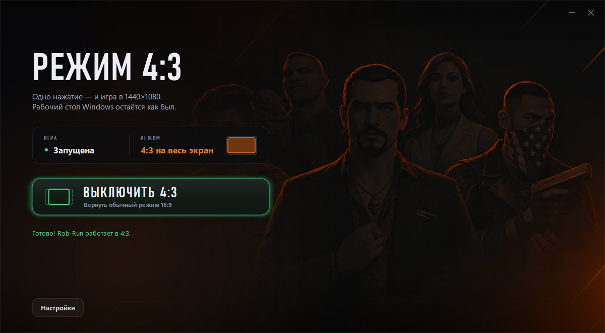
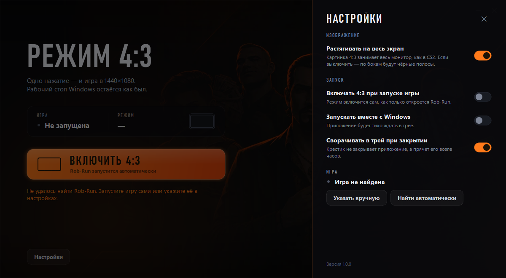

# RobRun Stretch

**Растянутое 4:3 для Rob-Run в один клик — без смены разрешения Windows.**

*Stretched 4:3 (1440×1080) for Rob-Run with one click, without changing the Windows desktop resolution. Open source, no network access, no injection into the game.*




## 📥 Скачать

Готовый `.exe` (последняя версия) лежит в Telegram-канале: **[t.me/vadim4ich](https://t.me/vadim4ich)**

Не хотите скачивать готовый файл — соберите его сами из этого кода, инструкция [ниже](#сборка-из-исходников).

## Что умеет

- **Настоящие 1440×1080.** Игра действительно рендерит картинку 4:3 (интерфейс и угол обзора перестраиваются), а не просто обрезает 16:9.
- **Растяг на весь экран, как в CS.** Картинку 4:3 можно растянуть на весь монитор.
- **Разрешение Windows не меняется.** Рабочий стол, браузер и остальные окна остаются в родном разрешении.
- **Alt+Tab без мигания.** Видеорежим монитора не переключается, поэтому нет чёрных экранов и задержек.
- **Одна кнопка.** Если игра не запущена, программа сама откроет её через Steam.
- **Всё возвращается само.** После выключения режима или выхода из игры настройки игры возвращаются как были.
- Тёмный интерфейс на русском, работа из трея, автозапуск с Windows (по желанию).

## Как пользоваться

1. Запустите `RobRunResolutionTool.exe`.
2. Откройте **Настройки** и включите **«Растягивать на весь экран»**, если нужен растяг. Без него по бокам будут чёрные полосы.
3. Нажмите **«Включить 4:3»**. Всё.

> При первом запуске Windows может показать «Система Windows защитила ваш компьютер». Это из-за того, что файл не подписан платным сертификатом. Нажмите **«Подробнее» → «Выполнить в любом случае»**. Если сомневаетесь — проверьте файл на [VirusTotal](https://www.virustotal.com) или соберите его сами из этого репозитория.



## 🔒 Безопасность — что программа делает и чего не делает

Весь код открыт, проверить каждый пункт можно самостоятельно.

**Не делает:**
- **Не выходит в интернет.** В коде нет ни одного сетевого запроса. `QLocalServer` в [`main.py`](main.py) — это локальный канал внутри компьютера, чтобы не запускались две копии программы.
- **Не лезет в процесс игры.** Нет чтения или записи памяти, внедрения DLL или хуков. Программа работает только с окном игры через обычные функции Windows.
- **Не собирает и не отправляет данные.** Пароли, браузеры, токены, Telegram, Discord и прочее программа не трогает.

**Делает (полный список):**

| Что | Где в коде | Зачем |
|---|---|---|
| Меняет размер и стиль окна игры, отправляет ему Alt+Enter | [`core/resolution_manager.py`](core/resolution_manager.py) | Перевести игру в окно 1440×1080 |
| Показывает окно-подложку и растягивает картинку через DWM | [`ui/stretch_overlay.py`](ui/stretch_overlay.py), [`core/compositor.py`](core/compositor.py) | Растянутое 4:3 |
| Прячет системный курсор и рисует свой, пока включён растяг | [`ui/stretch_overlay.py`](ui/stretch_overlay.py) | Чтобы курсор в меню совпадал с картинкой |
| Читает `HKCU\Software\Valve\Steam` и `libraryfolders.vdf` | [`core/process_manager.py`](core/process_manager.py) | Найти, где установлена игра |
| Сохраняет и восстанавливает `HKCU\Software\Kefir\ROB RUN` (только значения `Screenmanager*`) | [`core/game_prefs.py`](core/game_prefs.py) | Вернуть экранные настройки игры после выхода |
| Пишет `HKCU\...\CurrentVersion\Run` — только если включить автозапуск | [`config.py`](config.py) | Запуск вместе с Windows |
| Хранит настройки и лог в `%APPDATA%\RobRunResolutionTool` | [`config.py`](config.py) | Свои настройки |
| Запускает игру через `steam://rungameid/4262460` | [`core/process_manager.py`](core/process_manager.py) | Кнопка, когда игра закрыта |

## Как это работает

1. В режиме «полный экран в окне» Unity не даёт менять размер окна, поэтому программа сначала переводит игру в оконный режим через Alt+Enter.
2. В оконном режиме Unity рендерит картинку под размер окна. Программа убирает рамку и делает окно ровно 1440×1080 по центру. Это **настоящее** разрешение рендера, а не масштабирование.
3. **Растяг.** Поверх игры ставится полноэкранное окно, сквозь которое проходят клики. В нём через [DWM thumbnail](https://learn.microsoft.com/windows/win32/dwm/thumbnail-ovw) композитор Windows рисует кадр игры, растянутый до размера монитора. Видеорежим монитора не меняется, захвата экрана нет.
4. **Выключение** работает в обратную сторону: возвращает рамку окна, отправляет Alt+Enter и проверяет, что игра снова в полноэкранном режиме.

## Ограничения

- **Растяг добавляет до одного кадра задержки** (≈4 мс при 240 Гц) — так работает обычная композиция Windows. G-SYNC/FreeSync в режиме растяга, скорее всего, работать не будет.
- **Если разработчики отключат в игре Alt+Enter**, выберите в настройках игры оконный режим — дальше программа справится сама.
- **Программа не связана с разработчиками Rob-Run** и не одобрена ими. Она не изменяет игру, но вы используете её на свой страх и риск.

## Сборка из исходников

Нужны Windows 10/11 и Python 3.12+.

```bash
pip install -r requirements.txt
python main.py
```

Собрать один `.exe` (появится в `dist\`):

```bash
build.bat
```

Режим разработчика с технической информацией и живым логом: `Ctrl+Shift+D` в главном окне или `python main.py --dev`.

## Структура проекта

```
main.py                     запуск, одна копия программы, логирование
config.py                   настройки, автозапуск
core/win32.py               обёртки Windows API (ctypes)
core/process_manager.py     поиск игры в Steam, процесса и окна, запуск
core/resolution_manager.py  включение/выключение 4:3, проверка результата
core/compositor.py          DWM thumbnail, курсор
core/game_prefs.py          сохранение/восстановление экранных настроек игры
ui/controller.py            связка интерфейса и логики
ui/main_window.py           главное окно, настройки, трей
ui/stretch_overlay.py       растяг на весь экран
ui/backdrop.py              чёрная подложка в режиме с полосами
ui/widgets.py, ui/theme.py  кнопки, переключатели, стили
assets/                     фон и иконка
```

## 🐞 Нашли баг?

Создайте [Issue](../../issues) или напишите в Telegram **[@lavin_tyt](https://t.me/lavin_tyt)**. Обязательно приложите видео с багом — так проще и быстрее его исправить.

Новости и новые версии — в канале **[t.me/vadim4ich](https://t.me/vadim4ich)**.

## Лицензия

Код распространяется по лицензии [MIT](LICENSE).
Изображения в папке `assets/` в лицензию не входят. Rob-Run и связанные названия принадлежат их правообладателям.
